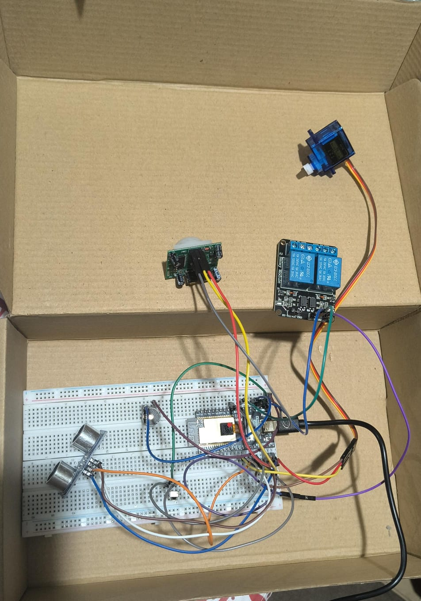

# Proyecto: AuraGuard (Sprint 2)

**Sistema de Seguridad Transportable (Monitoreo, Alerta y Bloqueo) — ESP32-CAM + IA**

---

## Descripción General

**AuraGuard** es un prototipo didáctico de domótica y seguridad inteligente diseñado para la protección perimetral de accesos. En este **Sprint 2** se incorporó una **ESP32-CAM** que publica frames por **MQTT** hacia un **servidor Python con OpenCV**, el cual detecta personas y **decide si activar la alarma**. La decisión viaja de regreso por MQTT hacia la ESP32 de sensores, cuyos actuadores (servo, zumbador y relé) responden a la orden.

El sistema trabaja con **dos placas independientes**:

* **ESP32 (sensores y actuadores):** PIR, ultrasónico, receptor IR, servo, zumbador y relé. Al detectar algo, avisa por MQTT y pide una foto a la cámara.
* **ESP32-CAM:** solo funciona como cámara. Publica frames en `auraguard/cam/frame`.
* **Servidor Python (PC):** recibe el frame, lo procesa con OpenCV, detecta personas y publica la decisión en `auraguard/actuadores/alarma/cmd`.

---

## Arquitectura del Sistema

```
 Sensores (PIR / Ultrasónico / IR)
              │
        ESP32 (sensores) ──MQTT──►  Mosquitto  ◄──MQTT── Servidor Python (OpenCV)
              ▲                   (broker local)                │
              │                          ▲                      │ detecta persona
              │                          │                      ▼
              │                   ESP32-CAM ──frame──►  auraguard/cam/frame
              │
              └──── auraguard/actuadores/alarma/cmd = ON ◄── decisión de la IA
                    (servo + zumbador + relé responden)
```

**Flujo:** sensor detecta → la ESP32 pide foto → la ESP32-CAM publica el frame → el servidor lo procesa → la IA decide → la ESP32 activa los actuadores.

---

## Tabla HAL

| # | Componente | Tipo | Pin | Tópico publicación | Tópico suscripción | Unidad | Rango |
|---|---|---|---|---|---|---|---|
| 1 | Sensor PIR HC-SR501 | Sensor | GPIO 13 | `auraguard/sensores/pir` | — | binario | 0 / 1 |
| 2 | Ultrasónico HC-SR04 | Sensor | TRIG 12 / ECHO 14 | `auraguard/sensores/distancia` | — | cm | 2 – 400 |
| 3 | Receptor IR VS1838B | Sensor | GPIO 19 | `auraguard/sensores/ir` | — | código NEC | hex |
| 4 | Servomotor SG90 | Actuador | GPIO 5 | `auraguard/actuadores/servo/estado` | `auraguard/actuadores/servo/cmd` | grados | 0 – 180 |
| 5 | Zumbador pasivo | Actuador | GPIO 15 | `auraguard/actuadores/zumbador/estado` | `auraguard/actuadores/zumbador/cmd` | on/off (2 kHz) | 0 / 1 |
| 6 | Módulo relé | Actuador | GPIO 18 | `auraguard/actuadores/rele/estado` | `auraguard/actuadores/rele/cmd` | binario | 0 / 1 |
| 7 | Alarma (servo + zumbador + relé) | Actuador | — | `auraguard/actuadores/alarma/estado` | `auraguard/actuadores/alarma/cmd` | on/off | ON / OFF |
| 8 | Armado del sistema | Estado | — | `auraguard/estado/sistema` | `auraguard/sistema/cmd` | texto | ARMAR / DESARMAR |
| 9 | ESP32-CAM OV2640 | Cámara | internos | `auraguard/cam/frame`, `auraguard/estado/cam` | `auraguard/cam/cmd` | imagen | 320×240 |

---

## Evidencia del Circuito Físico

*Montaje de componentes en protoboard para validación de hardware.*



*Montaje con las dos placas: ESP32 de sensores y actuadores + ESP32-CAM.*


---

## Evidencia: Datos llegando al Broker MQTT

*Consola de Mosquitto mostrando los tópicos de sensores, estado y cámara.*


---

## Evidencia: Frame procesado por OpenCV

*Frame de la ESP32-CAM procesado por el servidor, con la persona detectada.*


---

## Evidencia: Log frame recibido → IA detecta → actuador activado

*Salida del servidor (`servidor/logs/decisiones.log`).*

```
2026-11-13 [02:05:00] [MQTT] Conectado al broker localhost:1883
2026-11-13 [02:05:00] [ESTADO] Sistema ARMADO
2026-11-13 [02:05:00] [ESTADO] ESP32 ONLINE
2026-11-13 [02:05:00] [ESTADO] ESP32-CAM ONLINE
...
2026-11-13 [02:07:49] [FRAME] #84 320x240 150.0 KB -> [IA] 0 persona(s) (haar, 31 ms)
2026-11-13 [02:07:51] [FRAME] #85 320x240 150.0 KB -> [IA] 1 persona(s) (haar, 39 ms)
2026-11-13 [02:07:53] [FRAME] #86 320x240 150.0 KB -> [IA] 1 persona(s) (haar, 46 ms)
2026-11-13 [02:07:53] [ACTUADOR] IA detecta persona (disparador: PATRULLA) -> publico auraguard/actuadores/alarma/cmd = ON  => alarma activada
```

*Captura de la consola con la decisión de la IA:*


*Frame guardado automáticamente al activarse la alarma:*


---

## Evidencia: Falsa alarma descartada

*El sensor se activó pero la IA no vio a nadie en cámara, por lo que no se activó la alarma.*

```
2026-11-13 [02:09:07] [FRAME] #123 320x240 150.0 KB -> [IA] 0 persona(s) (haar, 23 ms)
2026-11-13 [02:09:08] [FRAME] #124 320x240 150.0 KB -> [IA] 0 persona(s) (haar, 16 ms)
2026-11-13 [02:09:08] [IA] Disparo de PIR sin persona en camara: falsa alarma DESCARTADA
```


---

## Estructura del Repositorio

```
equipo-03-Andre-Victor/
├── firmware/
│   ├── main.py               ← ESP32 de sensores y actuadores
│   ├── config.example.py     ← plantilla (el config.py real NO se sube)
│   ├── hal/                  ← sensores.py y actuadores.py
│   ├── cam/                  ← ESP32-CAM (main.py y camara.py)
│   └── pruebas/              ← test de cámara, decodificador IR, versión Sprint 1
├── servidor/
│   ├── mqtt_bridge.py        ← recibe frames, decide y publica al actuador
│   ├── ia/detector.py        ← detección con OpenCV (Haar / SSD)
│   ├── firebase_logger.py    ← registro de decisiones (opcional)
│   └── requirements.txt
├── firebase/                 ← reglas.json y esquema.md
├── docs/evidencias/          ← capturas del Sprint 2
└── README.md
```

---

## Cómo Ejecutar

1. **Broker:** `"C:\Program Files\mosquitto\mosquitto.exe" -c C:\mosquitto.conf -v`
2. **ESP32 de sensores:** subir `firmware/main.py`, la carpeta `hal/` y un `config.py` creado desde `config.example.py`.
3. **ESP32-CAM:** subir `firmware/cam/main.py` (como `main.py`), `camara.py` y su `config.py`.
4. **Servidor de IA:**
   ```
   cd servidor
   py -m pip install -r requirements.txt
   py mqtt_bridge.py
   ```

---

## Estado del Sprint 2

- [x] ESP32-CAM publicando frames por MQTT
- [x] ESP32 suscrita a tópicos de comando (servo, relé, zumbador, alarma, sistema)
- [x] Servidor Python recibiendo frames con OpenCV
- [ ] Detección → alarma probada de extremo a extremo
- [ ] Decisiones de la IA registradas en Firebase
- [ ] Carcasa iniciada (protoboard fijo y orificio para la cámara)

---

## Equipo

**Equipo 03 — Sistemas Programables, ISC TecNM León (ago-dic 2026)**

| Integrante | Matrícula |
|---|---|
| Andre | 23240369 |
| Victor | 23240496 |
