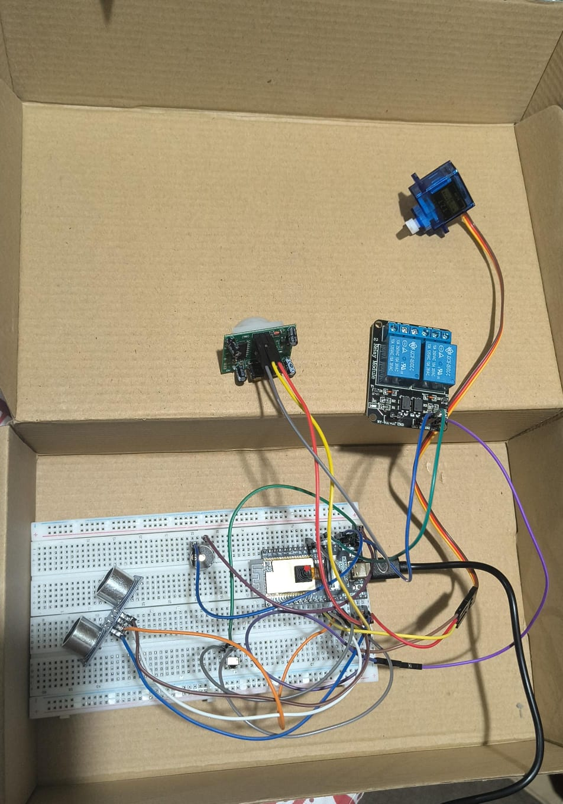

# 🛡️ Proyecto: AuraGuard (Sprint 1)
**Sistema de Seguridad Transportable (Monitoreo, Alerta y Bloqueo)**

---

## 📌 Descripción General
**AuraGuard** es un prototipo didáctico de domótica y seguridad inteligente diseñado para la protección perimetral de accesos. En este **Sprint 1**, se implementó el firmware base en MicroPython utilizando una placa **Freenove ESP32 WROVER**, la integración de sensores de presencia y proximidad, actuadores físicos de respuesta defensiva y comunicación en tiempo real mediante el protocolo **MQTT** con un broker local Mosquitto.

---

## 📸 Evidencia del Circuito Físico
*Montaje de componentes en protoboard para validación de hardware.*

---

## 📊 Tabla HALL (Hardware Abstraction Layer)
Especificación técnica de los pines físicos, tópicos de comunicación y rangos de operación de los componentes integrados:

| # | Componente | Tipo | Pin ESP32 | Tópico Publicación | Tópico Suscripción | Unidad | Rango |
| :--- | :--- | :--- | :--- | :--- | :--- | :--- | :--- |
| **1** | Sensor PIR | Sensor | `GPIO 13` | `auraguard/sensores/pir` | — | Binario | `0` o `1` |
| **2** | Sensor Ultrasónico | Sensor | `Trig: 12 / Echo: 14` | `auraguard/sensores/distancia` | — | cm | `2.0 - 400.0` |
| **3** | Receptor IR (Control) | Sensor | `GPIO 19` | `auraguard/estado/alerta` | — | Código HEX | `0xffa25d` (Armar) / `0xff629d` (Desarmar) |
| **4** | Servomotor (SG90) | Actuador | `GPIO 5` | — | `auraguard/actuadores/servo` | Grados | `0° - 90°` |
| **5** | Zumbador Pasivo | Actuador | `GPIO 15` | — | `auraguard/actuadores/zumbador` | Hz | `0` o `2000 Hz` |
| **6** | Módulo Relé | Actuador | `GPIO 18` | — | `auraguard/actuadores/rele` | Binario | `0` o `1` |
| **7** | ESP32-CAM | Cámara | `Cámara Integrada` | `auraguard/cam/frame` | — | JPEG | N/A |

## 💻 Evidencias de Ejecución y Monitoreo MQTT

### 1. Consola de Thonny (Firmware MicroPython)
Lecturas en tiempo real procesadas por el microcontrolador:

> *[Inserta aquí tu captura de consola, por ejemplo: ``]*

### 2. MQTT Explorer (Recepción de Tópicos)
Visualización del flujo de datos y estados de alerta publicados hacia el broker local (`192.168.1.12`):

> *[Inserta aquí tu captura de MQTT Explorer, por ejemplo: ``]*

---

## 🚀 Tecnologías y Herramientas Utilizadas
* **Microcontrolador:** Freenove ESP32 WROVER[cite: 4]
* **Lenguaje:** MicroPython[cite: 4]
* **IoT / Protocolo:** MQTT (Broker Mosquitto)[cite: 4]
* **IDE de Desarrollo:** Thonny[cite: 4]
